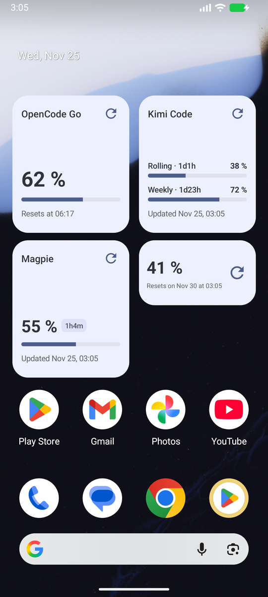

<h1 align="center">Quota Widget</h1>

<p align="center">
  <a href="README.md">English</a> ·
  <a href="README.zh-Hans.md">简体中文</a> ·
  <a href="README.zh-Hant.md">繁體中文</a> ·
  <a href="README.ja.md">日本語</a> ·
  <a href="README.de.md">Deutsch</a> ·
  <strong>Français</strong> ·
  <a href="README.ru.md">Русский</a>
</p>

<p align="center">
  Une application Android open source et une collection de widgets d'écran d'accueil pour suivre en un coup d'œil vos soldes d'API d'IA et vos quotas d'abonnement.
</p>

<p align="center">
  <a href="https://github.com/657kbps/quota-widget/releases/latest"></a>
  <a href="https://github.com/657kbps/quota-widget/releases"></a>
  
  
  
</p>

<p align="center">
  
  &nbsp;
  
  &nbsp;
  
</p>

## Fonctionnalités

- **Suivi multi-fournisseurs** : Consultez vos soldes et fenêtres de consommation pour DeepSeek, OpenCode Go, Codex, NewAPI, Magpie, Kimi Code, Zhipu Coding Plan, WorkBuddy, WorkBuddy International, Cline Pass, Command Code et Antigravity.
- **Dispositions de widgets flexibles** : Choisissez entre les formats Standard, Compact et Vue d'ensemble, avec affichage personnalisable (utilisé ou restant), style de barre de progression, indicateur d'heure de réinitialisation et aperçu en direct dans l'application.
- **Actualisation fiable en arrière-plan** : Mises à jour automatiques via WorkManager à l'intervalle de votre choix (de 15 minutes à 24 heures) et actualisation manuelle d'un simple appui depuis n'importe quel widget.
- **Stockage chiffré des identifiants** : Les clés API et jetons de session sont chiffrés avec Google Tink avant leur enregistrement dans DataStore Preferences.
- **Apparence personnalisable** : Thème clair, sombre ou suivant le système, avec couleurs dynamiques du système ou couleur d'accentuation personnalisée.
- **Interface multilingue** : Disponible en Français, English, 简体中文, 繁體中文, 日本語, Deutsch et Русский. Suit la langue du système par défaut (avec repli sur l'anglais) ou peut être configurée manuellement dans les Paramètres.
- **Conseils d'exécution en arrière-plan** : Invite de désactivation de l'optimisation de la batterie et recommandations propres aux constructeurs via [DontKillMyApp](https://dontkillmyapp.com/).
- **Vérification des mises à jour** : Contrôle optionnel des nouvelles versions sur GitHub Releases au lancement de l'application, ainsi qu'une vérification manuelle dans les Paramètres.

## Fournisseurs pris en charge

<details>
<summary><strong>Antigravity</strong></summary>

- **Données affichées** : Quotas de modèles 5 h et hebdomadaire
- **Authentification** : Connexion Google OAuth intégrée (intégration non officielle)
- **Widgets disponibles** : Standard · Compact · Vue d'ensemble

</details>

<details>
<summary><strong>Cline Pass</strong></summary>

- **Données affichées** : Utilisation 5 h, hebdomadaire et mensuelle
- **Authentification** : Connexion WorkOS intégrée ou clé API
- **Widgets disponibles** : Standard · Compact · Vue d'ensemble

</details>

<details>
<summary><strong>Codex</strong></summary>

- **Données affichées** : Quota d'abonnement hebdomadaire et mensuel (utilisé ou restant ; 5 h, hebdomadaire et mensuel en Vue d'ensemble)
- **Authentification** : Connexion OAuth intégrée
- **Widgets disponibles** : Standard · Compact · Vue d'ensemble

</details>

<details>
<summary><strong>Command Code</strong></summary>

- **Données affichées** : Limites 5 h, hebdomadaire et mensuelle ainsi que crédits mensuels
- **Authentification** : Connexion Studio intégrée ou clé API
- **Widgets disponibles** : Standard · Compact · Vue d'ensemble

</details>

<details>
<summary><strong>DeepSeek</strong></summary>

- **Données affichées** : Solde du compte API (devise d'affichage CNY / USD configurable)
- **Widgets disponibles** : Standard · Compact

</details>

<details>
<summary><strong>Kimi Code</strong></summary>

- **Données affichées** : Quota 5 h, hebdomadaire et mensuel (selon la formule ; utilisé ou restant)
- **Configuration** : Clé API et sélection de région Chine / International
- **Widgets disponibles** : Standard · Compact · Vue d'ensemble

</details>

<details>
<summary><strong>Magpie</strong></summary>

- **Données affichées** : Quotas d'abonnement par fournisseur sur une passerelle Magpie auto-hébergée (5 h, hebdomadaire et mensuel ; agrégation de plusieurs comptes d'un même fournisseur ; sélection du fournisseur, par défaut le premier renvoyé)
- **Configuration** : URL de la passerelle et clé API de passerelle
- **Widgets disponibles** : Standard · Compact · Vue d'ensemble

</details>

<details>
<summary><strong>NewAPI</strong></summary>

- **Données affichées** : Solde du jeton (USD) et pourcentage utilisé/restant
- **Configuration** : URL de base, clé API et taux de conversion du quota
- **Widgets disponibles** : Solde Standard · Solde Compact · Utilisation

</details>

<details>
<summary><strong>OpenCode Go</strong></summary>

- **Données affichées** : Quota glissant, hebdomadaire et mensuel (utilisé ou restant)
- **Authentification** : Connexion web intégrée (avec choix de l'espace de travail) ou clé API
- **Widgets disponibles** : Standard · Compact · Vue d'ensemble

</details>

<details>
<summary><strong>WorkBuddy</strong></summary>

- **Données affichées** : Crédit mensuel
- **Authentification** : Connexion par navigateur intégrée
- **Widgets disponibles** : Standard · Compact · Vue d'ensemble

</details>

<details>
<summary><strong>WorkBuddy International</strong></summary>

- **Données affichées** : Crédit mensuel (édition internationale)
- **Authentification** : Connexion par navigateur intégrée
- **Widgets disponibles** : Standard · Compact · Vue d'ensemble

</details>

<details>
<summary><strong>Zhipu Coding Plan</strong></summary>

- **Données affichées** : Quota 5 h et hebdomadaire (utilisé ou restant)
- **Configuration** : Clé API et sélection de région Chine / International
- **Widgets disponibles** : Standard · Compact · Vue d'ensemble

</details>

> **Authentification intégrée**
> Les connexions par navigateur (OpenCode Go, Codex, WorkBuddy, WorkBuddy International, Cline Pass, Command Code et Antigravity) s'effectuent directement dans une WebView intégrée à l'application. La redirection de rappel est capturée automatiquement : vous n'avez pas besoin de copier manuellement l'URL de callback.

> **Avertissement concernant Antigravity**
> Antigravity repose sur une intégration non officielle ; Google est susceptible d'appliquer des restrictions ou contrôles sur les comptes concernés. Il est recommandé de vous connecter d'abord au client de bureau officiel Antigravity et d'y initialiser un projet avant de vous authentifier dans cette application, et d'évaluer le risque par vous-même.

## Installation et prise en main

### Téléchargement

Téléchargez la dernière version APK signée depuis [GitHub Releases](https://github.com/657kbps/quota-widget/releases/latest).

- **Identifiant du package (Release)** : `com.kuyermqi.quotawidget`
- **Version Android minimale** : Android 8.0 (niveau d'API 26)

### Configuration

1. Installez et ouvrez **Quota Widget**, puis désactivez l'optimisation de la batterie lorsque cela vous est proposé afin de garantir le bon fonctionnement des actualisations en arrière-plan.
2. Sur l'écran d'accueil, sélectionnez un fournisseur, saisissez vos identifiants ou terminez la connexion, ajustez les préférences d'affichage si nécessaire et enregistrez.
3. Effectuez un appui long sur une zone libre de votre écran d'accueil, ouvrez **Widgets** et placez la disposition Quota Widget souhaitée.
4. Appuyez sur le bouton d'actualisation d'un widget pour récupérer immédiatement les données les plus récentes.

> Certaines surcouches Android de constructeurs limitent encore les tâches en arrière-plan après la désactivation de l'optimisation de batterie standard. Consultez [DontKillMyApp](https://dontkillmyapp.com/) pour connaître les autorisations de démarrage automatique et d'exécution en arrière-plan propres à votre appareil.

## Compiler depuis les sources

### Build Debug

```bash
./gradlew :androidApp:assembleDebug
```

L'APK généré est placé dans `androidApp/build/outputs/apk/debug/`.

La variante debug utilise l'identifiant de package `com.kuyermqi.quotawidget.debug` (nom dans le lanceur : **Quota Widget Debug**), ce qui permet de l'installer côte à côte avec la version release.

### Vérification locale Release (R8)

Pour vérifier localement la minification R8 et la réduction des ressources avec le keystore de debug (à des fins de test uniquement ; ne pas distribuer) :

```bash
./gradlew :androidApp:assembleRelease -PallowDebugReleaseSigning=true
```

### Architecture et pile technique

| Module | Rôle |
|--------|------|
| `shared` | Couche partagée Kotlin Multiplatform (KMP) : modèles de domaine, clients API des fournisseurs, logique d'actualisation et dépôt de paramètres chiffrés |
| `androidApp` | Interface Jetpack Compose, flux de connexion WebView intégrés, Glance AppWidgets, tâches WorkManager et ressources Android |

**Technologies principales** : Kotlin (KMP) · Jetpack Compose · Glance AppWidget · Ktor · kotlinx.serialization · DataStore · Tink · WorkManager · Material Kolor

## Signature et publication des versions

Les APK destinés à la distribution doivent être signés avec un keystore dédié (jamais avec le keystore de debug).

1. **Générer un keystore** (opération unique ; conservez le fichier et les mots de passe en lieu sûr) :

   ```bash
   keytool -genkeypair -v \
     -keystore release.keystore \
     -alias quota-widget \
     -keyalg RSA -keysize 2048 -validity 10000
   ```

2. **Configurer les secrets GitHub Actions** (*Settings → Secrets and variables → Actions*) :

   | Secret | Description |
   |--------|-------------|
   | `RELEASE_KEYSTORE_BASE64` | Keystore encodé en Base64 : `base64 -w0 release.keystore` (Linux/macOS) ou `[Convert]::ToBase64String([IO.File]::ReadAllBytes("release.keystore"))` (PowerShell) |
   | `RELEASE_STORE_PASSWORD` | Mot de passe du keystore |
   | `RELEASE_KEY_ALIAS` | Alias de la clé (ex. `quota-widget`) |
   | `RELEASE_KEY_PASSWORD` | Mot de passe de la clé |

3. **Publier une version** en poussant un tag de version :

   ```bash
   git tag v1.0.0 && git push origin v1.0.0
   ```

Pour compiler un APK release signé en local, exportez les variables d'environnement suivantes :

```bash
export RELEASE_STORE_FILE=/path/to/release.keystore
export RELEASE_STORE_PASSWORD=...
export RELEASE_KEY_ALIAS=quota-widget
export RELEASE_KEY_PASSWORD=...
./gradlew :androidApp:assembleRelease
```

## Contribuer

Les signalements d'anomalies (Issues) et les Pull Requests sont les bienvenus. Avant de contribuer, veuillez consulter [AGENTS.md](AGENTS.md) pour prendre connaissance des conventions de code, des choix d'architecture et des limites entre modules.

Les messages de commit doivent respecter la norme [Conventional Commits](https://www.conventionalcommits.org/), par exemple :

```text
feat: add 2x1 compact DeepSeek balance widget
fix: keep WorkManager Room constructors under R8 full mode
```

## Remerciements

- [DontKillMyApp](https://dontkillmyapp.com/) — Guides de maintien en arrière-plan par constructeur
- Les API et services ouverts proposés par DeepSeek, OpenCode et les autres plateformes prises en charge

---

<p align="center">
  Si ce projet vous est utile, n'hésitez pas à lui attribuer une étoile ⭐
</p>
