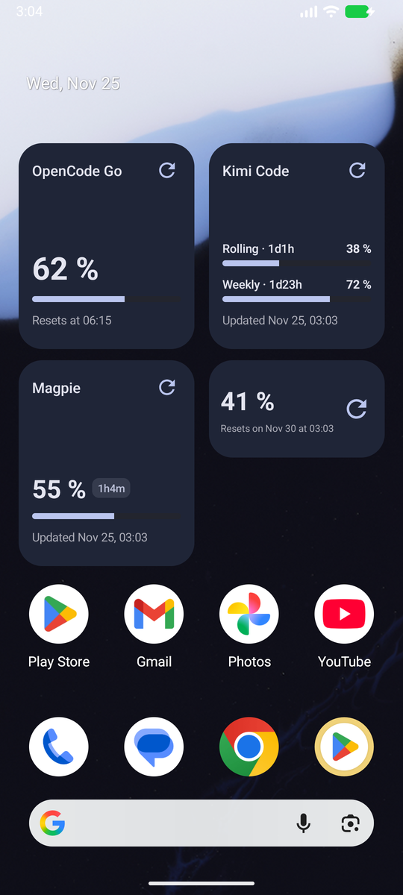

<h1 align="center">Quota Widget</h1>

<p align="center">
  <a href="README.md">English</a> ·
  <a href="README.zh-Hans.md">简体中文</a> ·
  <a href="README.zh-Hant.md">繁體中文</a> ·
  <a href="README.ja.md">日本語</a> ·
  <a href="README.de.md">Deutsch</a> ·
  <a href="README.fr.md">Français</a> ·
  <strong>Русский</strong>
</p>

<p align="center">
  Приложение с открытым исходным кодом и набор виджетов для главного экрана Android, позволяющие отслеживать баланс API и квоты подписок ИИ-сервисов с одного взгляда.
</p>

<p align="center">
  <a href="https://github.com/657kbps/quota-widget/releases/latest"></a>
  <a href="https://github.com/657kbps/quota-widget/releases"></a>
  
  
  
</p>

<p align="center">
  
  &nbsp;
  
  &nbsp;
  
</p>

## Основные возможности

- **Мониторинг множества провайдеров**: отслеживание баланса и квот подписок для DeepSeek, OpenCode Go, Codex, NewAPI, Magpie, Kimi Code, Zhipu Coding Plan, WorkBuddy, WorkBuddy International, Cline Pass, Command Code и Antigravity.
- **Гибкие макеты виджетов**: Стандартный, Компактный и Обзорный форматы с настройкой отображения использованного или оставшегося объёма, стилей шкалы прогресса, времени сброса и предпросмотром в реальном времени внутри приложения.
- **Надёжное фоновое обновление**: автоматическая синхронизация через WorkManager с настраиваемым интервалом (от 15 минут до 24 часов), а также мгновенное обновление вручную нажатием на виджет.
- **Шифрованное хранение учётных данных**: API-ключи и токены сессий шифруются с помощью Google Tink перед сохранением в DataStore Preferences.
- **Настройка оформления**: светлая, тёмная и системная темы оформления, а также динамические цвета системы или собственный акцентный цвет.
- **Многоязычный интерфейс**: поддержка языков Русский, English, 简体中文, 繁體中文, 日本語, Deutsch и Français. По умолчанию используется язык системы (с откатом на английский) с возможностью ручного переключения в настройках.
- **Рекомендации для фоновой работы**: подсказки по отключению оптимизации батареи и инструкции для устройств разных производителей на базе [DontKillMyApp](https://dontkillmyapp.com/).
- **Проверка обновлений**: опциональная проверка новых версий на GitHub Releases при запуске приложения и ручная проверка в настройках.

## Поддерживаемые платформы

<details>
<summary><strong>Antigravity</strong></summary>

- **Отображаемые данные**: квоты моделей за 5 часов и неделю
- **Авторизация**: вход через Google OAuth в приложении (неофициальная интеграция)
- **Доступные виджеты**: Стандартный · Компактный · Обзор

</details>

<details>
<summary><strong>Cline Pass</strong></summary>

- **Отображаемые данные**: использование за 5 часов, неделю и месяц
- **Авторизация**: вход через WorkOS в приложении или API-ключ
- **Доступные виджеты**: Стандартный · Компактный · Обзор

</details>

<details>
<summary><strong>Codex</strong></summary>

- **Отображаемые данные**: недельная и месячная квоты подписки (использовано или остаток; в Обзоре — за 5 часов, неделю и месяц)
- **Авторизация**: OAuth-вход в приложении
- **Доступные виджеты**: Стандартный · Компактный · Обзор

</details>

<details>
<summary><strong>Command Code</strong></summary>

- **Отображаемые данные**: лимиты за 5 часов, неделю и месяц, а также ежемесячные кредиты
- **Авторизация**: вход через Studio в приложении или API-ключ
- **Доступные виджеты**: Стандартный · Компактный · Обзор

</details>

<details>
<summary><strong>DeepSeek</strong></summary>

- **Отображаемые данные**: баланс API-аккаунта (настраиваемая валюта отображения: CNY / USD)
- **Доступные виджеты**: Стандартный · Компактный

</details>

<details>
<summary><strong>Kimi Code</strong></summary>

- **Отображаемые данные**: квоты за 5 часов, неделю и месяц (в зависимости от тарифа; использовано или остаток)
- **Настройка**: API-ключ и выбор региона (Китай / Глобальный)
- **Доступные виджеты**: Стандартный · Компактный · Обзор

</details>

<details>
<summary><strong>Magpie</strong></summary>

- **Отображаемые данные**: квоты подписок по провайдерам для собственного шлюза Magpie (5 часов, неделя и месяц; объединение нескольких аккаунтов одного провайдера; выбор провайдера, по умолчанию — первый из ответа шлюза)
- **Настройка**: URL шлюза и API-ключ шлюза
- **Доступные виджеты**: Стандартный · Компактный · Обзор

</details>

<details>
<summary><strong>NewAPI</strong></summary>

- **Отображаемые данные**: баланс токена (USD) и процент использования/остатка
- **Настройка**: Base URL, API-ключ и коэффициент пересчёта квоты
- **Доступные виджеты**: Баланс (Стандартный) · Баланс (Компактный) · Использование

</details>

<details>
<summary><strong>OpenCode Go</strong></summary>

- **Отображаемые данные**: скользящая, недельная и месячная квоты (использовано или остаток)
- **Авторизация**: веб-вход в приложении (с выбором рабочего пространства) или API-ключ
- **Доступные виджеты**: Стандартный · Компактный · Обзор

</details>

<details>
<summary><strong>WorkBuddy</strong></summary>

- **Отображаемые данные**: ежемесячный лимит кредитов
- **Авторизация**: вход через встроенный браузер
- **Доступные виджеты**: Стандартный · Компактный · Обзор

</details>

<details>
<summary><strong>WorkBuddy International</strong></summary>

- **Отображаемые данные**: ежемесячный лимит кредитов (международная версия)
- **Авторизация**: вход через встроенный браузер
- **Доступные виджеты**: Стандартный · Компактный · Обзор

</details>

<details>
<summary><strong>Zhipu Coding Plan</strong></summary>

- **Отображаемые данные**: квоты за 5 часов и неделю (использовано или остаток)
- **Настройка**: API-ключ и выбор региона (Китай / Глобальный)
- **Доступные виджеты**: Стандартный · Компактный · Обзор

</details>

> **Авторизация внутри приложения**
> Вход через браузер (OpenCode Go, Codex, WorkBuddy, WorkBuddy International, Cline Pass, Command Code и Antigravity) выполняется во встроенном компоненте WebView. Callback-ответ перехватывается автоматически — копировать URL вручную не требуется.

> **Предупреждение об Antigravity**
> Интеграция с Antigravity использует неофициальный API, в связи с чем Google может применять ограничения к связанным аккаунтам. Рекомендуется предварительно войти в официальный настольный клиент Antigravity и инициализировать проект, а затем выполнять вход в данном приложении, самостоятельно оценивая возможные риски.

## Установка и быстрый старт

### Загрузка

Загрузите актуальный подписанный APK-файл со страницы [GitHub Releases](https://github.com/657kbps/quota-widget/releases/latest).

- **Идентификатор пакета (Release)**: `com.kuyermqi.quotawidget`
- **Минимальная версия Android**: Android 8.0 (API 26)

### Настройка

1. Установите и откройте **Quota Widget**, затем отключите оптимизацию батареи по запросу приложения, чтобы фоновые обновления выполнялись стабильно.
2. На главном экране выберите провайдера, введите учётные данные или пройдите авторизацию, при необходимости настройте параметры отображения и сохраните изменения.
3. Нажмите и удерживайте пустую область рабочего стола, откройте раздел **Виджеты** и добавьте нужный макет виджета Quota Widget.
4. Нажмите кнопку обновления на любом виджете, чтобы немедленно получить актуальные данные.

> Некоторые фирменные оболочки Android продолжают ограничивать фоновые процессы даже после отключения стандартной оптимизации батареи. Инструкции по настройке автозапуска и разрешений для конкретных производителей приведены на сайте [DontKillMyApp](https://dontkillmyapp.com/).

## Сборка из исходного кода

### Debug-сборка

```bash
./gradlew :androidApp:assembleDebug
```

Готовый APK сохраняется в `androidApp/build/outputs/apk/debug/`.

Отладочная сборка имеет идентификатор пакета `com.kuyermqi.quotawidget.debug` (название в лаунчере — **Quota Widget Debug**) и может устанавливаться параллельно с релизной версией.

### Локальная проверка Release-сборки (R8)

Для локальной проверки обфускации R8 и сжатия ресурсов с использованием debug-ключа (только для тестирования, не для распространения):

```bash
./gradlew :androidApp:assembleRelease -PallowDebugReleaseSigning=true
```

### Архитектура и стек технологий

| Модуль | Назначение |
|--------|------------|
| `shared` | Общий модуль Kotlin Multiplatform (KMP): доменные модели, API-клиенты провайдеров, интерактор обновления и шифрованное хранилище настроек |
| `androidApp` | Интерфейс на Jetpack Compose, встроенная авторизация через WebView, виджеты Glance AppWidget, задачи WorkManager и ресурсы Android |

**Ключевые технологии**: Kotlin (KMP) · Jetpack Compose · Glance AppWidget · Ktor · kotlinx.serialization · DataStore · Tink · WorkManager · Material Kolor

## Подпись и публикация релизов

Релизные APK должны подписываться отдельным keystore (использовать debug-keystore запрещено).

1. **Создайте keystore** (выполняется один раз; надёжно сохраните файл и пароли):

   ```bash
   keytool -genkeypair -v \
     -keystore release.keystore \
     -alias quota-widget \
     -keyalg RSA -keysize 2048 -validity 10000
   ```

2. **Настройте секреты GitHub Actions** (*Settings → Secrets and variables → Actions*):

   | Секрет | Значение |
   |--------|----------|
   | `RELEASE_KEYSTORE_BASE64` | Keystore в кодировке Base64: `base64 -w0 release.keystore` (Linux/macOS) или `[Convert]::ToBase64String([IO.File]::ReadAllBytes("release.keystore"))` (PowerShell) |
   | `RELEASE_STORE_PASSWORD` | Пароль от keystore |
   | `RELEASE_KEY_ALIAS` | Псевдоним ключа (например, `quota-widget`) |
   | `RELEASE_KEY_PASSWORD` | Пароль ключа |

3. **Опубликуйте релиз**, отправив тег версии:

   ```bash
   git tag v1.0.0 && git push origin v1.0.0
   ```

Для локальной сборки подписанного релизного APK задайте следующие переменные окружения:

```bash
export RELEASE_STORE_FILE=/path/to/release.keystore
export RELEASE_STORE_PASSWORD=...
export RELEASE_KEY_ALIAS=quota-widget
export RELEASE_KEY_PASSWORD=...
./gradlew :androidApp:assembleRelease
```

## Участие в разработке

Будем рады вашим Issue и Pull Request. Перед внесением изменений ознакомьтесь с руководством [AGENTS.md](AGENTS.md), где описаны правила оформления кода, архитектурные соглашения и границы модулей.

Сообщения коммитов должны соответствовать спецификации [Conventional Commits](https://www.conventionalcommits.org/), например:

```text
feat: add 2x1 compact DeepSeek balance widget
fix: keep WorkManager Room constructors under R8 full mode
```

## Благодарности

- [DontKillMyApp](https://dontkillmyapp.com/) — руководства по сохранению фоновой работы для различных производителей Android
- [LINUX DO](https://linux.do/) — обсуждения и обратная связь от сообщества
- DeepSeek, OpenCode и другие поддерживаемые платформы за предоставленные открытые API и сервисы

---

<p align="center">
  Если проект оказался полезным, будем признательны за ⭐
</p>
