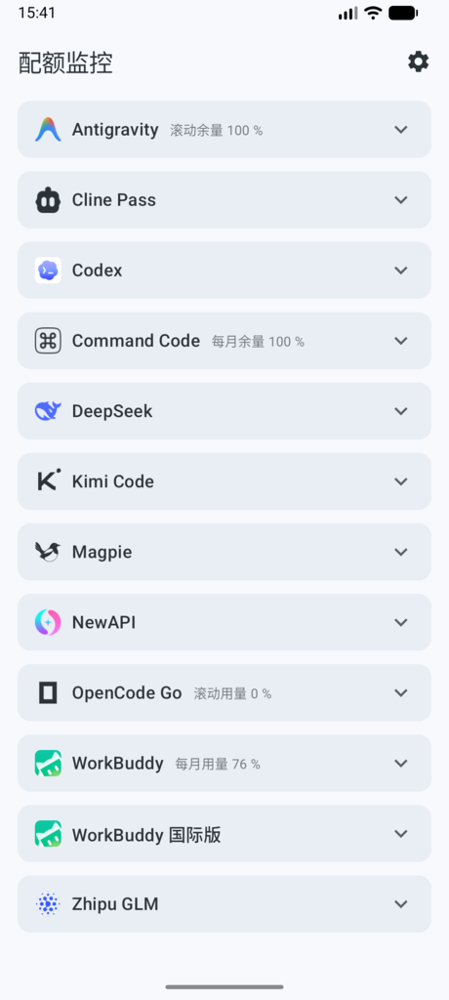

<h1 align="center">配額監控 · Quota Widget</h1>

<p align="center">
  <a href="README.md">English</a> ·
  <a href="README.zh-Hans.md">简体中文</a> ·
  <strong>繁體中文</strong> ·
  <a href="README.ja.md">日本語</a> ·
  <a href="README.de.md">Deutsch</a> ·
  <a href="README.fr.md">Français</a> ·
  <a href="README.ru.md">Русский</a>
</p>

<p align="center">
  一款開源的 Android 應用程式與桌面小工具套件，讓您在主畫面上直覺掌握各類 AI API 帳戶餘額與訂閱配額使用情形。
</p>

<p align="center">
  <a href="https://github.com/657kbps/quota-widget/releases/latest"></a>
  <a href="https://github.com/657kbps/quota-widget/releases"></a>
  
  
  
</p>

<p align="center">
  
  &nbsp;
  
  &nbsp;
  
</p>

## 功能特色

- **多平台配額監控**：支援檢視 DeepSeek、OpenCode Go、Codex、NewAPI、Magpie、Kimi Code、Zhipu Coding Plan、WorkBuddy、WorkBuddy 國際版、Cline Pass、Command Code 及 Antigravity 的帳戶餘額與訂閱用量。
- **多樣化小工具版面**：提供標準、緊湊與總覽三種版面配置，支援自訂用量／餘量顯示、進度條樣式、重設時間顯示與應用程式內即時預覽。
- **可靠的背景更新**：透過 WorkManager 依設定間隔（15 分鐘至 24 小時）自動更新資料，並支援於小工具上輕觸手動重新整理。
- **加密憑證儲存**：API 金鑰與工作階段權杖在寫入 DataStore Preferences 前，皆經 Google Tink 加密保護。
- **自訂外觀主題**：支援淺色、深色與跟隨系統模式，並可選用動態系統色彩或自訂主題色。
- **多語言介面**：提供繁體中文、简体中文、English、日本語、Deutsch、Français 與 Русский 七種介面語言，預設跟隨系統語言（不支援時回退為英文），亦可於設定中手動切換。
- **背景運行指引**：提供關閉電池最佳化的引導提示，並附上 [DontKillMyApp](https://dontkillmyapp.com/) 的各品牌裝置設定參考。
- **版本更新檢查**：支援於啟動時自動檢查 GitHub Releases 新版本，亦可於設定頁面手動檢查。

## 支援的平台

<details>
<summary><strong>Antigravity</strong></summary>

- **顯示內容**：5 小時與每週模型配額
- **驗證方式**：應用程式內 Google OAuth 登入（非官方串接）
- **可用小工具**：標準 · 緊湊 · 總覽

</details>

<details>
<summary><strong>Cline Pass</strong></summary>

- **顯示內容**：5 小時、每週與每月用量
- **驗證方式**：應用程式內 WorkOS 登入或 API 金鑰
- **可用小工具**：標準 · 緊湊 · 總覽

</details>

<details>
<summary><strong>Codex</strong></summary>

- **顯示內容**：每週與每月訂閱配額（可設定顯示用量或餘量；總覽同時呈現 5 小時、每週與每月）
- **驗證方式**：應用程式內 OAuth 登入
- **可用小工具**：標準 · 緊湊 · 總覽

</details>

<details>
<summary><strong>Command Code</strong></summary>

- **顯示內容**：5 小時、每週與每月限額及每月點數
- **驗證方式**：應用程式內 Studio 登入或 API 金鑰
- **可用小工具**：標準 · 緊湊 · 總覽

</details>

<details>
<summary><strong>DeepSeek</strong></summary>

- **顯示內容**：API 帳戶餘額（可設定 CNY / USD 顯示幣別）
- **可用小工具**：標準 · 緊湊

</details>

<details>
<summary><strong>Kimi Code</strong></summary>

- **顯示內容**：5 小時、每週與每月配額（依方案回傳而定，可設定用量或餘量）
- **設定項目**：API 金鑰與中國版／國際版站點切換
- **可用小工具**：標準 · 緊湊 · 總覽

</details>

<details>
<summary><strong>Magpie</strong></summary>

- **顯示內容**：自架 Magpie 閘道各供應商的訂閱額度（5 小時、每週與每月；自動彙整同供應商下的多個帳號；可選擇顯示的供應商，預設取閘道回傳的第一個）
- **設定項目**：閘道位址與閘道 API 金鑰
- **可用小工具**：標準 · 緊湊 · 總覽

</details>

<details>
<summary><strong>NewAPI</strong></summary>

- **顯示內容**：權杖餘額（USD）與配額用量／餘量百分比
- **設定項目**：Base URL、API 金鑰與配額換算比例
- **可用小工具**：金額標準 · 金額緊湊 · 使用情況

</details>

<details>
<summary><strong>OpenCode Go</strong></summary>

- **顯示內容**：滾動、每週與每月配額（可設定顯示用量或餘量）
- **驗證方式**：應用程式內網頁登入（可選工作區）或 API 金鑰
- **可用小工具**：標準 · 緊湊 · 總覽

</details>

<details>
<summary><strong>WorkBuddy</strong></summary>

- **顯示內容**：每月點數額度
- **驗證方式**：應用程式內瀏覽器登入
- **可用小工具**：標準 · 緊湊 · 總覽

</details>

<details>
<summary><strong>WorkBuddy 國際版</strong></summary>

- **顯示內容**：每月點數額度（國際版）
- **驗證方式**：應用程式內瀏覽器登入
- **可用小工具**：標準 · 緊湊 · 總覽

</details>

<details>
<summary><strong>Zhipu Coding Plan</strong></summary>

- **顯示內容**：5 小時與每週配額（可設定用量或餘量）
- **設定項目**：API 金鑰與中國版／國際版站點切換
- **可用小工具**：標準 · 緊湊 · 總覽

</details>

> **關於應用程式內登入**
> OpenCode Go、Codex、WorkBuddy、WorkBuddy 國際版、Cline Pass、Command Code 與 Antigravity 的瀏覽器登入流程皆於應用程式內 WebView 中完成，授權回呼會自動擷取並帶入，無須手動複製回呼 URL。

> **Antigravity 使用須知**
> Antigravity 採用非官方介面串接，Google 可能會對相關帳號進行風控或限制。建議先於官方 Antigravity 桌面用戶端登入並完成專案初始化，再於本應用程式中登入，並請自行評估相關風險。

## 安裝與快速開始

### 下載安裝

請前往 [GitHub Releases](https://github.com/657kbps/quota-widget/releases/latest) 下載最新的已簽署 APK 進行安裝。

- **正式版套件名稱**：`com.kuyermqi.quotawidget`
- **最低系統版本**：Android 8.0（API 26）

### 設定步驟

1. 安裝並開啟**配額監控**，依提示關閉電池最佳化，以確保背景排程更新能正常執行。
2. 於主畫面點選欲監控的平台，輸入 API 金鑰或完成帳號登入，依需求調整顯示偏好後儲存。
3. 長按桌面空白處，開啟**小工具**選單，將所需的配額監控小工具新增至主畫面。
4. 點選小工具上的重新整理按鈕，即可立即更新最新資料。

> 部分客製化 Android 系統在關閉標準電池最佳化後，仍可能限制背景執行。如需進一步開放自動啟動或背景執行權限，請參閱 [DontKillMyApp](https://dontkillmyapp.com/) 中對應裝置品牌的說明。

## 從原始碼建置

### Debug 建置

```bash
./gradlew :androidApp:assembleDebug
```

建置產物位於 `androidApp/build/outputs/apk/debug/`。

Debug 版本的套件名稱為 `com.kuyermqi.quotawidget.debug`（桌面應用程式名稱為 **Quota Widget Debug**），可與正式版本並存安裝。

### 本機 Release 驗證（R8）

若需在本機以偵錯金鑰驗證 R8 程式碼最佳化與資源縮減（僅供開發驗證，請勿對外發布）：

```bash
./gradlew :androidApp:assembleRelease -PallowDebugReleaseSigning=true
```

### 模組架構與技術堆疊

| 模組 | 職責說明 |
|------|----------|
| `shared` | Kotlin Multiplatform（KMP）共用層，包含領域模型、各平台 API 用戶端、更新互動層及加密設定儲存庫 |
| `androidApp` | Jetpack Compose 介面、應用程式內 WebView 登入流程、Glance 桌面小工具、WorkManager 背景工作與 Android 資源 |

**核心技術**：Kotlin (KMP) · Jetpack Compose · Glance AppWidget · Ktor · kotlinx.serialization · DataStore · Tink · WorkManager · Material Kolor

## Release 簽署與發布

正式發布的 APK 必須使用專用的 Release Keystore 簽署，切勿使用 Debug Keystore。

1. **建立 Keystore**（僅需執行一次，請妥善備份金鑰檔案與密碼）：

   ```bash
   keytool -genkeypair -v \
     -keystore release.keystore \
     -alias quota-widget \
     -keyalg RSA -keysize 2048 -validity 10000
   ```

2. **設定 GitHub Actions Secrets**（路徑：*Settings → Secrets and variables → Actions*）：

   | Secret | 說明 |
   |--------|------|
   | `RELEASE_KEYSTORE_BASE64` | 經 Base64 編碼的 keystore：Linux/macOS 可執行 `base64 -w0 release.keystore`，PowerShell 可執行 `[Convert]::ToBase64String([IO.File]::ReadAllBytes("release.keystore"))` |
   | `RELEASE_STORE_PASSWORD` | Keystore 密碼 |
   | `RELEASE_KEY_ALIAS` | 金鑰別名（例如 `quota-widget`） |
   | `RELEASE_KEY_PASSWORD` | 金鑰密碼 |

3. **推送標籤以發布版本**：

   ```bash
   git tag v1.0.0 && git push origin v1.0.0
   ```

若需於本機建置正式簽署的 APK，請先設定以下環境變數：

```bash
export RELEASE_STORE_FILE=/path/to/release.keystore
export RELEASE_STORE_PASSWORD=...
export RELEASE_KEY_ALIAS=quota-widget
export RELEASE_KEY_PASSWORD=...
./gradlew :androidApp:assembleRelease
```

## 參與貢獻

歡迎提出 Issue 與 Pull Request。在貢獻程式碼前，請先參閱 [AGENTS.md](AGENTS.md)，了解專案的編碼規範、架構約定與模組邊界。

提交訊息請遵循 [Conventional Commits](https://www.conventionalcommits.org/) 規範，例如：

```text
feat: add 2x1 compact DeepSeek balance widget
fix: keep WorkManager Room constructors under R8 full mode
```

## 致謝

- [DontKillMyApp](https://dontkillmyapp.com/) — 各品牌 Android 裝置的背景執行設定指南
- DeepSeek、OpenCode 等各支援平台所提供的開放介面與服務

---

<p align="center">
  如果這個專案對您有所幫助，歡迎點選 Star 支持 ⭐
</p>
